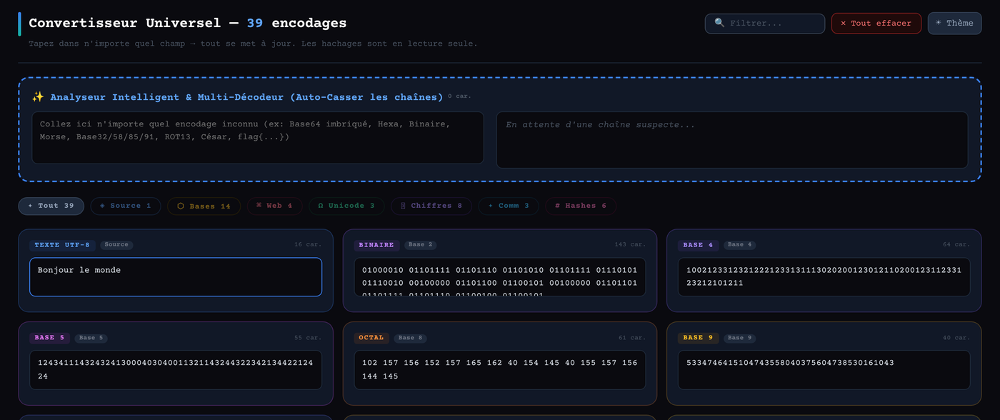
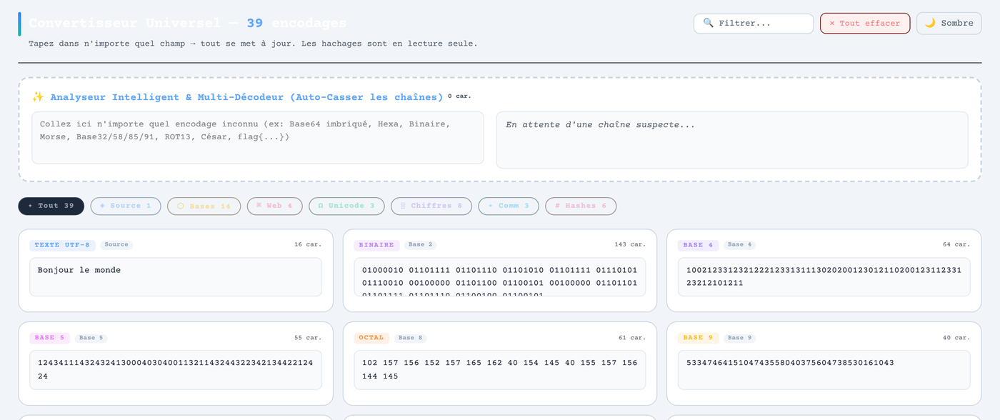
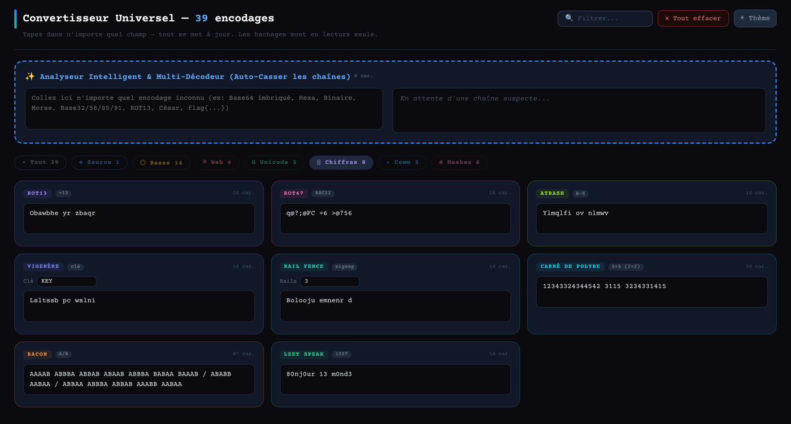
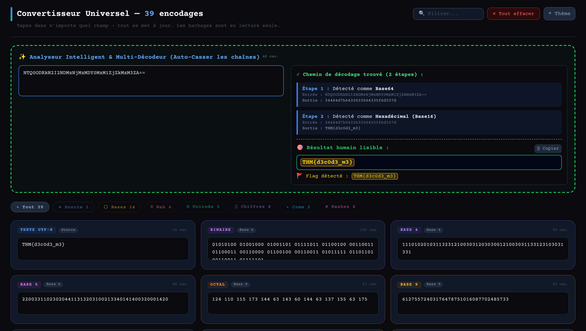
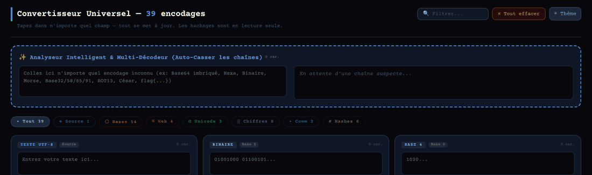

<h1 align="center">🔄 Convertisseur Universel</h1>

<p align="center">
  <strong>39 encodages, un fichier, zéro dépendance.</strong><br>
  Encodez, décodez et dénouez les chaînes à plusieurs couches — entièrement dans le navigateur.
</p>

<p align="center">
  
  
  
  
  
  
</p>

<p align="center">
  <a href="https://mourchidfolarin.github.io/convertiseur/"></a>
</p>

<p align="center"><sub>La démo en ligne sera disponible une fois <a href="https://docs.github.com/pages">GitHub Pages</a> activé sur le dépôt<br>(source : branche <code>main</code>, dossier <code>/</code>) — adresse prévue : <a href="https://mourchidfolarin.github.io/convertiseur/">mourchidfolarin.github.io/convertiseur</a>.</sub></p>

<p align="center">
  
</p>

---

## Sommaire

- [Fonctionnalités](#fonctionnalités)
- [Encodages supportés](#encodages-supportés)
- [Analyseur intelligent](#analyseur-intelligent)
- [Utilisation](#utilisation)
- [Cas d'usage CTF](#cas-dusage-ctf)
- [Structure du projet](#structure-du-projet)
- [Sécurité](#sécurité)
- [Contribution](#contribution)
- [Licence](#licence)
- [Auteur](#auteur)

---

## Fonctionnalités

- **39 encodages synchronisés** — tapez dans n'importe quel champ, tous les autres se mettent à jour instantanément.
- **Analyseur intelligent** — détecte et décode automatiquement les chaînes à plusieurs couches, puis surligne les flags CTF (`THM{}`, `flag{}`, `CTF{}`, `picoCTF{}`, `HTB{}`…).
- **Filtres par catégorie** et **barre de recherche** pour n'afficher que ce dont vous avez besoin (Bases, Web, Chiffres, Hashes…).
- **Thème sombre ou clair**, mémorisé dans le navigateur, tout comme le dernier filtre choisi.
- **Compteur de caractères** sur chaque carte, boutons **Copier** et **Tout effacer**.
- **Paramètres de chiffrement** : clé pour Vigenère, nombre de rails pour Rail Fence.
- **Hashes en lecture seule** (SHA-1, SHA-256, SHA-512, MD5, CRC-32, Adler-32) — on calcule, on ne « déhash » pas.
- **Un seul fichier HTML**, aucune dépendance, aucun serveur : ouvrez `index.html` et ça marche, même hors ligne.

<p align="center">
  
  <br>
  <sub>Le thème clair, un clic suffit.</sub>
</p>

---

## Encodages supportés

### ◈ Source

| Encodage | Détail |
| :--- | :--- |
| Texte UTF-8 | Point d'entrée, texte brut |

### ⬡ Bases (14)

| Encodage | Détail |
| :--- | :--- |
| Binaire | Base 2 |
| Base 4 | Alphabet `0123` |
| Base 5 | Alphabet `01234` |
| Octal | Base 8 |
| Base 9 | Alphabet `012345678` |
| Décimal ASCII | Base 10, octets séparés |
| Hexadécimal (espaces) | Base 16, octets séparés |
| Hex compact | Base 16, sans espaces |
| Hex `0x` prefix | Format `0xNN` |
| Base 32 | RFC 4648 |
| Base 58 | Alphabet Bitcoin |
| Base 64 | RFC 4648 |
| Ascii85 / Base 85 | Style PostScript (`<~ … ~>`) |
| Base 91 | Base91 |

### ⌘ Web (4)

| Encodage | Détail |
| :--- | :--- |
| URL encodé | Percent-encoding |
| Entités HTML | `&amp;`, `&lt;`, `&#…;`… |
| Quoted-Printable | MIME |
| UUencode | Unix |

### Ω Unicode (3)

| Encodage | Détail |
| :--- | :--- |
| Unicode `\uXXXX` | Échappements JS / Python |
| `charCodeAt` | Codes séparés par des virgules |
| A1Z26 | A = 1 … Z = 26 |

### ⚿ Chiffres (8)

| Encodage | Détail |
| :--- | :--- |
| ROT13 | Décalage de 13 lettres |
| ROT47 | Décalage sur l'ASCII imprimable |
| Atbash | A ↔ Z |
| Vigenère | Chiffrement par clé (champ **Clé**) |
| Rail Fence | Zigzag, nombre de **rails** réglable |
| Carré de Polybe | Grille 5×5 (I = J) |
| Bacon | Alphabet A/B |
| Leet speak | `1337` |

<p align="center">
  
  <br>
  <sub>Les 8 chiffrements, filtrés d'un clic — avec les champs Clé et Rails.</sub>
</p>

### ✦ Comm (3)

| Encodage | Détail |
| :--- | :--- |
| Code Morse | Signaux `·` / `-` |
| Alphabet OTAN | Alphabet phonétique (Alpha, Bravo…) |
| Braille | Caractères braille Unicode |

### # Hashes (6) — lecture seule

| Empreinte | Taille |
| :--- | :--- |
| SHA-256 | 256 bits |
| SHA-1 | 160 bits |
| SHA-512 | 512 bits |
| MD5 | 128 bits |
| CRC-32 | Checksum |
| Adler-32 | Checksum |

---

## Analyseur intelligent

Collez une chaîne dont vous ignorez le format : l'analyseur teste une vingtaine d'encodages, **du plus spécifique au plus général**, et enchaîne jusqu'à 12 couches. Dès qu'un flag apparaît, il s'arrête et le surligne. Le texte décodé remplit aussi la grille, et un bouton **Copier** reprend le résultat.

Il reconnaît notamment : binaire, hexadécimal, octal, décimal ASCII, Base32 / 58 / 64 (y compris URL-safe) / 85 / 91, Ascii85, Morse, Bacon, A1Z26, entités HTML, percent-encoding, Quoted-Printable, échappements Unicode (`\uXXXX`, `\xNN`, `U+`), ROT13, ROT47, Atbash, et **César** (quand le texte ressemble clairement à de l'anglais ou du français, ou qu'un flag apparaît — pour limiter les faux positifs).

<p align="center">
  
</p>

### Exemple

Partons du flag `THM{d3c0d3_m3}`, encodé d'abord en hexadécimal, puis en Base64 :

```text
THM{d3c0d3_m3}
  → hex     54484d7b6433633064335f6d337d
  → Base64  NTQ0ODRkN2I2NDMzNjMzMDY0MzM1ZjZkMzM3ZA==
```

Collez `NTQ0ODRkN2I2NDMzNjMzMDY0MzM1ZjZkMzM3ZA==` dans l'analyseur :

1. **Base64** → `54484d7b6433633064335f6d337d`
2. **Hexadécimal** → `THM{d3c0d3_m3}`
3. 🚩 **Flag détecté** et surligné

<p align="center">
  
</p>

---

## Utilisation

Aucune installation, aucune compilation.

1. **En local** — ouvrez simplement `index.html` dans votre navigateur (double-clic, ou glissez le fichier dans un onglet).
2. **En ligne** — une fois GitHub Pages activé, rendez-vous sur [mourchidfolarin.github.io/convertiseur](https://mourchidfolarin.github.io/convertiseur/).

Ensuite :

- saisissez du texte dans **n'importe quelle** carte : les autres se mettent à jour ;
- pour Vigenère ou Rail Fence, ajustez la **clé** ou le nombre de **rails** ;
- collez une chaîne inconnue dans l'**analyseur** en haut de page ;
- filtrez par catégorie, cherchez un encodage, basculez le thème.

> Astuce : le thème et le filtre actif sont mémorisés dans `localStorage`, uniquement sur votre machine.

---

## Cas d'usage CTF

Le convertisseur est pensé pour les challenges d'OSINT, de stéganographie et de crypto « classique » :

- **dénouer une chaîne à plusieurs couches** (Base64 → hex → texte, Morse, Bacon…) sans ouvrir dix onglets ;
- **repérer un flag** du type `THM{}`, `flag{}`, `picoCTF{}`, `HTB{}` au milieu d'un décodage ;
- **tester un chiffrement** (ROT, Atbash, César via l'analyseur, Vigenère, Rail Fence, Polybe) en direct ;
- **vérifier une empreinte** (MD5, SHA-1/256/512, CRC-32, Adler-32) — les hashes sont à sens unique, l'outil les calcule, il ne les inverse pas.

---

## Structure du projet

```text
convertiseur/
├── index.html          # Application complète (interface + logique)
├── README.md
├── LICENSE             # MIT
└── assets/
    ├── apercu.png      # Vue principale, thème sombre
    ├── theme-clair.png # Thème clair
    ├── chiffres.png    # Filtre « Chiffres »
    ├── analyseur.png   # Décodage multi-couches + flag
    └── demo.gif        # Saisie dans l'analyseur
```

Tout tient dans `index.html` : styles, interface et algorithmes. Pas de framework, pas de bundler, pas d'appel réseau une fois la page chargée.

---

## Sécurité

- **Tout reste local.** Le texte n'est jamais envoyé à un serveur : les conversions s'exécutent dans votre navigateur.
- **Aucune dépendance tierce**, donc pas de script externe à télécharger ni à auditer.
- **L'affichage est échappé** : une chaîne qui contient du HTML ou du JavaScript est montrée comme du texte, pas exécutée.
- Les préférences (thème, filtre) restent dans le `localStorage` de votre navigateur.

Vous pouvez l'utiliser hors ligne, y compris sur une machine isolée : copiez `index.html` et ouvrez-le.

---

## Contribution

Les suggestions, issues et pull requests sont les bienvenues. Quelques repères pour rester cohérent avec le projet :

- conserver **un seul fichier** applicatif, sans dépendance ;
- garder l'interface en **français** ;
- pour un nouvel encodage, l'ajouter à la grille **et**, s'il s'y prête, à l'analyseur, en évitant les faux positifs sur du texte courant ;
- les hashes restent en **lecture seule**.

---

## Licence

Ce projet est publié sous licence [MIT](LICENSE). Copyright © 2026 Mourchid FOLARIN.

---

## Auteur

**Mourchid FOLARIN** — étudiant en L3, développeur backend (PHP / Laravel), passionné de cybersécurité. Lokossa, Bénin.

<p align="center">
  <a href="https://github.com/MourchidFOLARIN"></a>
  <a href="https://www.linkedin.com/in/mourchid-folarin-60b711374/"></a>
  <a href="https://mourchidfolarin.vercel.app/"></a>
</p>
